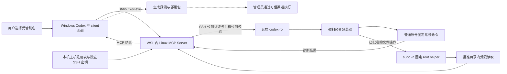

# Linux MCP Server：Windows / WSL 访问受管 CentOS

基于 [rhel-lightspeed/linux-mcp-server](https://github.com/rhel-lightspeed/linux-mcp-server) 的 fork，为 CentOS 6/7/8/Stream 提供固定只读诊断、独立 SSH 身份、管理员部署包及 Codex client Skill。目标是让 AI 在明确的主机和目录边界内排查问题；远端安装、权限调整和卸载由管理员执行。

**请从本仓库源码安装。** PyPI 的 `linux-mcp-server`、上游容器、上游 MCP Registry 名称和上游文档对应上游项目，不能证明包含本 fork 的纳管 CLI、兼容包装器与 Skill。本仓库当前默认分支是 `codex/centos7-compat-1.5.0`。

## 实现方案



这是一套本地 MCP 加 SSH 包装器的方案。MCP 主程序在 WSL 运行，远端无需运行 MCP 服务或现代 Python 应用，只安装专用账号、root 管理的策略与兼容 Python 2.6/3.x 的包装器。

| 层次 | 职责 | 源码入口 |
| --- | --- | --- |
| client Skill | 选择主机、组织诊断、控制确认节点与管理员交接 | [SKILL.md](skills/linux-mcp-server-client/SKILL.md) |
| 本机安装脚本 | 安装 WSL 工具、生成当前机器的 Codex MCP 配置 | [bootstrap_wsl_mcp.py](skills/linux-mcp-server-client/scripts/bootstrap_wsl_mcp.py) |
| 主机生命周期 CLI | discover、import-profile、prepare、verify、refresh、rebuild-deployment | [manage_linux_hosts.py](scripts/manage_linux_hosts.py) |
| MCP 工具与 SSH | 参数校验、能力选择、连接复用、格式化输出 | [tools](src/linux_mcp_server/tools)、[ssh.py](src/linux_mcp_server/connection/ssh.py) |
| 主机注册表 | 将别名绑定到地址、端口、身份、批准根目录和能力画像 | [host_registry.py](src/linux_mcp_server/host_registry.py) |
| 远端包装器与安装器 | 强制命令、参数白名单、文件边界与专用账号检查 | [scripts/centos](scripts/centos) |
| root 读取 helper | 固定 JSON 请求、root 管理策略、描述符校验和资源限制 | [linux-mcp-privileged-read](scripts/centos/linux-mcp-privileged-read) |

`linux-centos-ro` 是客户端 MCP 配置名；`linux-mcp-hosts` 是本机 CLI；`server-a` 等才是传给 MCP 的 `host`。受管模式通过注册表确定连接信息，不依赖 `~/.ssh/config` 中存在同名别名。

## 能力与安全边界

启用的固定工具共 19 个，兼容程度以每台主机探测和验收结果为准：

| 类别 | 工具 | 用途 |
| --- | --- | --- |
| 系统 | `get_system_information`、`get_cpu_information`、`get_memory_information`、`get_disk_usage`、`get_hardware_information` | 操作系统、CPU、内存、文件系统容量和硬件信息 |
| 服务 | `list_services`、`get_service_status`、`get_service_logs` | 服务列表、状态和服务日志 |
| 进程 | `list_processes`、`get_process_info` | 进程资源占用和指定 PID 详情 |
| 网络 | `get_network_interfaces`、`get_network_connections`、`get_listening_ports` | 接口、连接和监听端口 |
| 日志 | `get_journal_logs`、`read_log_file` | 按条件查询 journal 或读取指定日志尾部 |
| 存储与文件 | `list_block_devices`、`list_directories`、`list_files`、`read_file` | 块设备、目录/文件列表和受限文本读取 |

- 使用 `fixed` 工具集，并在客户端列出 19 项工具白名单；不启用上游支持的 `run_script`/`both` 模式。
- `LINUX_MCP_REQUIRE_MANAGED_HOST=true` 拒绝遗漏 `host`、未登记主机和非受管工具，不能把裸 IP 当作绕过注册表的捷径。
- 每台主机的密钥和 known_hosts 独立，主机公钥由管理员通过可信渠道提供；不将 `ssh-keyscan` 作为身份依据。
- 远端账号为 `codex-ro`，密码锁定，公钥认证被强制交给包装器。系统操作仍以该账号执行；受控 root 读取模式仅调用一个固定 helper，不开放 root SSH 登录。
- 读取模式 `user` 保留普通 POSIX/ACL 语义；`privileged` 由 helper 在 root 身份下读取批准范围内的普通文件、日志和目录元数据。只读约束操作行为，路径批准本身不会授予 Linux 文件权限。
- helper 不新增常驻服务或端口，只接收有长度上限的标准输入 JSON，不接收任意命令。它按 root 管理策略逐层安全打开，再验证最终文件描述符；拒绝特殊文件、路径替换、越界和硬链接文件，并限制字节、行数和运行时间。
- 安装器拒绝宽泛 sudo，只接受本工具精确 helper 授权；helper 为 root:root 0700，策略及父目录由 root 控制，sudoers 为 0440。普通用户不能直接执行或修改 helper。
- `readOnlyHint` 是工具声明，实际限制依靠账号权限、强制命令与策略；仅安装 Skill 或设置客户端工具列表不足以建立远端边界。

画像 schema v2 支持每台服务器 **1..16 个非 `/`、互不重叠的 `allowed_roots`**；旧 schema v1 单根画像仍可读取并迁移，缺少 `read_mode` 时维持 `user`，不会自动获得 root 读取。系统信息等固定查询还会访问包装器允许的系统路径；业务根目录并不是对所有系统工具的全局文件沙箱。

选择 `privileged` 会扩大批准目录内的实际可见内容，必须先明确根目录范围；不得自动扩大根。ACL/读取组仍可用于普通权限管理，但 root 文件不必逐个补 ACL。root 或拥有完整 sudo 的管理员能够修改这些规则；共享 `codex-ro` 或其私钥的人不能被识别为不同调用者。

专用 sudoers 的核心规则如下，空字符串表示不允许命令行参数，语义见 [sudo 官方源码手册](https://github.com/sudo-project/sudo/blob/main/docs/sudoers.man.in)：

```sudoers
Defaults:codex-ro !requiretty
codex-ro ALL=(root) NOPASSWD: /usr/local/libexec/linux-mcp-privileged-read ""
```

helper 还会检查内核记录的父进程 UID 与调用身份，兼容 sudo 的监护进程和直接 exec 模式，不只信任环境变量或 JSON 参数。目标 sudo 版本由安装器 `visudo` 和权限查询检查，不支持时停止，不退回通用 sudo 授权。批准根路径不能包含符号链接；硬链接文件也会被明确拒绝。

| 系统 | SSH 身份策略 | 兼容限制 |
| --- | --- | --- |
| CentOS 6 | 明确批准后使用 RSA 4096；旧 `ssh-rsa` 例外仅限该主机 | 缺少 systemd/journalctl 的能力可能 unsupported；部分工具退回 procfs、chkconfig、df、netstat |
| CentOS 7 | Ed25519 | 旧 free、lsblk、findmnt、ip 等需要兼容输出解析 |
| CentOS 8 / Stream 8、9 | Ed25519 | 以实际软件与权限探测结果为准；画像当前只接受 CentOS major 6、7、8、9 |

`exact` 表示能力与预期一致，`partial` 表示明确降级，`unsupported` 表示不支持并返回可识别错误。CentOS Stream 10、任意 Linux 发行版和所有补丁版本均不在此表的承诺范围；支持的 major 也不等于每项工具都在真实机器验证过。

## 别人如何安装

### 1. 准备环境并克隆本 fork

控制端需要 Windows Codex、WSL（下文以 Ubuntu 为例），以及 WSL 内的 `git`、`uv`、OpenSSH 客户端、Node.js 22.12+ 与 npm。MCP 包要求 Python >=3.10，本安装脚本选择 Python 3.11 独立工具环境。`uv` 安装方式见 [Astral 官方文档](https://docs.astral.sh/uv/getting-started/installation/)。远端需要 SSH 服务、Bash，以及安装器调用的 `/usr/bin/python`（兼容 Python 2.6/3.x）；管理员须能执行安装步骤。

在 **WSL 终端**运行，将源码留在 WSL 原生文件系统：

```sh
mkdir -p ~/src
git clone --branch codex/centos7-compat-1.5.0 \
  https://github.com/lalala8462/linux-mcp-server.git ~/src/linux-mcp-server
cd ~/src/linux-mcp-server
git rev-parse HEAD
cd mcp-app
npm ci
npm run build:prod
cd ..
```

记录完整提交号用于复现。当前 Python 打包配置强制包含 `mcp-app/dist`，因此 fixed 模式也须先构建该前端资产；这不会启用脚本执行工具。不要用 `pip install linux-mcp-server` 或上游容器替代本 fork；不要长期从 `/mnt/c`、`/mnt/g` 等挂载盘运行生命周期命令。

### 2. 安装 client Skill 与 MCP 配置

在 **Windows PowerShell** 中执行；如实际发行版不同，修改 `$Distro`：

```powershell
$Distro = 'Ubuntu'
$WslHome = (wsl.exe -d $Distro -- sh -lc 'printf "%s" "$HOME"').Trim()
$RepoInWsl = "$WslHome/src/linux-mcp-server"
$SkillSource = (wsl.exe -d $Distro -- wslpath -w "$RepoInWsl/skills/linux-mcp-server-client").Trim()
$SkillParent = Join-Path $env:USERPROFILE '.agents\skills'
$SkillTarget = Join-Path $SkillParent 'linux-mcp-server-client'
if (Test-Path -LiteralPath $SkillTarget) { throw 'Skill 已存在，请先核对版本，不自动覆盖。' }
New-Item -ItemType Directory -Path $SkillParent -Force | Out-Null
Copy-Item -LiteralPath $SkillSource -Destination $SkillTarget -Recurse

$CodexDir = if ($env:CODEX_HOME) { $env:CODEX_HOME } else { Join-Path $env:USERPROFILE '.codex' }
$ConfigInWsl = (wsl.exe -d $Distro -- wslpath -u (Join-Path $CodexDir 'config.toml')).Trim()
wsl.exe -d $Distro -- python3 "$RepoInWsl/skills/linux-mcp-server-client/scripts/bootstrap_wsl_mcp.py" --repository $RepoInWsl --mcp-config $ConfigInWsl --distribution $Distro
```

当前官方用户 Skill 目录是 `~/.agents/skills`，参见 [OpenAI Skills 文档](https://learn.chatgpt.com/docs/build-skills)。已有客户端如使用 `~/.codex/skills`，按实际目录安装一次；不要在两个目录重复安装同名 Skill。

bootstrap 安装 `linux-mcp-server`、`linux-mcp-hosts`，将模板中的 WSL home 和发行版替换为当前机器值，并原子更新 Codex 的 `linux-centos-ro` 主段和环境段。它不读取其他人的配置，不创建主机、密钥或远端账号；非标准现有配置会停止并要求人工核对。

配置来源为 [codex-mcp-snippet.toml](config/codex-mcp-snippet.toml)，关键项如下：

| 配置 | 本方案值或用途 |
| --- | --- |
| `command` / `args` | `wsl.exe` 启动当前 WSL 原生安装的 `linux-mcp-server` |
| `enabled_tools` | 19 个固定工具；不是安装器或卸载器 |
| `LINUX_MCP_TOOLSET` | `fixed` |
| `LINUX_MCP_REQUIRE_MANAGED_HOST` | `true`，强制注册表别名 |
| `LINUX_MCP_HOST_REGISTRY_PATH` | WSL `~/.local/share/linux-mcp-server/hosts` |
| `LINUX_MCP_VERIFY_HOST_KEYS` | `true` |
| `WSLENV` | 将 Windows MCP 环境变量传入 WSL，不可遗漏 |
| 读取量与超时 | 模板为文件最多 1 MiB、单命令 30 秒、工具调用 60 秒 |

模板中单主机密钥路径与通用目录是兼容占位；受管调用采用每台主机画像中的身份和根目录，不能将模板占位当作已登记服务器。手工配置时须保持上述边界，字段定义见 [OpenAI MCP 文档](https://learn.chatgpt.com/docs/extend/mcp?surface=cli)。

新开 Codex 会话，检查：

```powershell
codex mcp list
wsl.exe -d $Distro -- "$WslHome/.local/bin/linux-mcp-hosts" --help
wsl.exe -d $Distro -- "$WslHome/.local/bin/linux-mcp-hosts" list
```

`codex mcp list` 只证明配置存在；首次没有主机时列表为空是正常现象。接下来在 Codex 输入“使用 $linux-mcp-server-client 新增服务器”，提供该机器的 IPv4、端口和批准根目录。

### 3. 纳管并验收服务器

完整可执行命令见 [主机生命周期](skills/linux-mcp-server-client/references/host-lifecycle.md)，顺序为：

1. `discover` 生成无密钥探测包，输出两种路径和 SHA256。
2. 管理员通过可信渠道上传、核验摘要、执行探测并回传 JSON 与主机公钥文件。
3. `import-profile` 绑定地址、端口、全部批准根目录和能力矩阵；每个根重复一个 `--allowed-root`，确认 partial/unsupported。
4. `prepare` 核对可信公钥后才生成独立客户端密钥和部署包；私钥留在 WSL。已明确接受受控 root 读取时加 `--read-mode privileged`，普通模式为 `user`。
5. 管理员核验部署包 SHA256，执行实际输出的 `install_command`。CentOS 6 与其他版本的公钥文件名和参数不同，不手工套用固定命令。
6. root 模式安装器在每个根创建 `.linux-mcp-verify` 非敏感样本：普通文本、root 专属文本/日志、0700 目录和根外符号链接。`verify` 经真实 MCP 调用 19 项能力及额外读取/拒绝检查，全部通过才记为已验收；无需先给样本补 ACL。

在日常会话中先列出注册表并选择别名，再将该别名作为每次 MCP 调用的 `host`。可请求“检查 server-a 的内存、磁盘与监听端口”或“读取 server-a 批准目录下应用日志的最近 100 行”。示例别名不是实际主机。

## 维护、权限与退役

- 升级前核对分支与提交，保留未提交改动；从审查过的源码重跑 bootstrap。复制 Skill 与重装 MCP 是独立动作，不会自动同步。旧 SSH 配置不作为现代受管连接的事实来源。
- 包装器/安装器更新后用 `rebuild-deployment` 复用密钥生成新包，管理员安装后重新验收；不要手工重组部署包。
- OS、主机公钥或能力变化后重新探测，通过 `refresh` 展示差异，确认后才接受并重新准备。
- 已纳管主机升级 root 读取，用 `rebuild-deployment --alias server-a --read-mode privileged --output <新包.tar.gz>`。复用原账号、密钥和主机身份，保留原 allowed_roots；管理员增量安装后再 `verify --alias server-a`，不删除账号重新纳管。生成新包会使原 verified 状态失效。
- 普通模式权限失败请管理员检查 `namei -l`、`stat`、`id codex-ro`、`getfacl`。稳定读取 root 文件采用明确批准的 helper 模式；helper 失败时核对模式、策略、专用 sudoers 和解释器，不将权限错误伪装为成功、空日志或 unsupported。
- 远端安装器仍使用 `/usr/bin/python`，不按 CentOS 大版本猜测 Python 版本。升级包必须同时包含 helper、包装器、安装器、策略、公钥与摘要清单；只重发旧包装器不会获得 helper 能力。
- 卸载由本机生成仅含公开卸载脚本的包，管理员执行 `--confirm-account codex-ro`。卸载不自动重新纳管，本机材料另行按明确授权处理。
- 单台退役保留其他主机与共享 MCP 配置；全部主机退役并得到授权后才移除共享入口。管理员脚本保留历史备份，本机清理使用回收站/Trash。
- `wsl --shutdown` 后现有 MCP transport 失效，新开会话。挂载盘 I/O 卡顿时避免重复启动进程，恢复后使用原生 WSL CLI。

远端安装器的账号检查、受管标记和备份行为见 [管理员部署细节](docs/centos-readonly-overlay.md)。

## 优点与代价

| 方面 | 优点 | 代价或限制 |
| --- | --- | --- |
| 安全控制 | 客户端白名单、受管身份、远端强制命令和系统权限构成多层限制 | Skill 是行为约定，需配合真实部署；只读仍会暴露批准范围内的数据 |
| root 文件 | 固定 helper 补充目录内读取权限，日志重建不再依赖逐文件 ACL | 增加了受控 root 代码的维护成本；批准范围内的 root 数据会变得可见，必须审查范围 |
| 旧系统兼容 | 远端不需要现代 Python MCP 环境，按能力选择兼容命令 | CentOS 6 的旧 RSA 算法与缺失工具需要显式接受，不能补齐不存在的服务语义 |
| 多主机 | 一个 MCP 入口，多份独立身份与画像，未知别名默认拒绝 | 本机需保护注册表与无交互使用的私钥，管理规模扩大后需要轮换与集中治理 |
| 权限分工 | AI 只诊断，管理员审核执行部署和卸载 | 首次纳管需多次交接；文件权限与轮转配置仍须管理员维护 |
| 可验证性 | 19 项能力矩阵、稳定降级标记和逐主机验收 | 静态单元测试、画像声明与真实远端验收各有范围，不能互相代替 |
| 性能 | SSH 连接复用、命令超时和读取量限制 | 目录大小排序可能扫描大树；`top_n` 限制返回条数，不保证只扫描少量文件 |
| 数据治理 | 密钥和部署状态留本机，部署包不含私钥 | 日志可能记录地址、别名、路径和命令；返回文件/日志会进入 AI 会话上下文，不是离线数据隔离方案 |
| 部署 | WSL 原生安装避开长期挂载盘执行问题 | 依赖 Windows/WSL 生命周期，WSL 重启后需重建 MCP 连接 |

当前默认审计日志位于 WSL `~/.local/share/linux-mcp-server/logs`，默认保留轮转数量为 10；这不是“绝不记录服务器信息”的保证。目录、进程参数及日志内容都应按组织的数据规则控制。

## Skill 与 MCP 的优化结论

本次整理已经落实：

- 将“选择主机、诊断边界、确认节点”留在短 SKILL.md，安装和生命周期细节按需读取；不再每次诊断加载全部管理员命令。
- 去掉个人盘符、Windows 用户和固定发行版假设；仓库与配置路径必须显式提供。
- 主机注册表成为唯一主入口，不再将旧 SSH 配置列表混入可访问列表。
- `list` 一次展示连接目标、读取模式与状态，减少为了选择服务器反复查询能力矩阵。
- 不发布旧的一阶段 `prepare_wsl_client.py`：它与两阶段 CLI 重复，并包含提前生成密钥和网络取主机公钥的旧路径。正式密钥与部署包统一由 CLI 管理；卸载仅用小型独立打包脚本。
- 使用 CLI 真实输出的公钥文件名与安装命令，避免 CentOS 6 错用 Ed25519 示例。
- 将 root 文件读取统一到显式模式和专用 helper；安装器区分精确授权与宽泛 sudo，部署包包含全部资产，并扩展真实 MCP 验收。目录验收只扫描样本树，避免为验收遍历整个业务树。
- 卸载不默认重新新增，单机退役不移除共享 MCP；静态审查不强制选择远端。
- 合并 README.personal 与兼容说明中的重复总览；移除指向上游发布物的徽章和 Registry 标记，保留明确的上游归属与许可证。

后续建议，尚未在本次实现：

| 优先级 | 调整 | 收益与边界 |
| --- | --- | --- |
| 高 | 给生命周期 CLI 增加 `list --json`/脱敏输出与安全退役规划 | 方便自动化和可审核的逐主机清理；保留明确授权与共享资源检查 |
| 中 | 为 prepare/refresh 增加事务性与可重试失败状态 | 降低密钥或画像已写入、部署包生成失败后的恢复成本 |
| 中 | 建立 fork 自己的发布、依赖锁定和版本化 Skill 分发 | 明确安装到的 fork 提交，减少上游包与本地安装漂移；当前 `uv tool install` 不等于按 uv.lock 锁定依赖 |
| 中 | 将 fixed 模式打包与可选前端 UI 构建解耦 | 当前 fixed 模式安装仍依赖 Node/npm 构建；需兼顾上游脚本模式的资源完整性 |
| 中 | 为目录分析增加扫描预算、取消/超时与截断信息 | 缓解大树扫描负载，不能仅依赖 top_n |
| 中 | 审计元数据脱敏与可配置保留策略 | 保留排障证据，同时减少地址、路径等信息扩散 |
| 低 | 评估打包为包含 Skill 与本地 MCP 的插件 | 可减少安装步骤，需单独解决 WSL 路径与身份材料初始化；当前不是一键插件 |

## 已上传什么，哪些内容留在本机

本仓库包含 MCP Python 源码、主机 CLI、远端 collector/包装器/root helper/安装卸载脚本、公开配置模板、测试、文档，以及 `skills/linux-mcp-server-client` 完整公开 Skill。普通 Python wheel 分发 MCP 与打包的生命周期资产（含 helper）；Skill 和配置模板按此 README 从 Git 仓库取得，不能仅凭 wheel 推断它们已安装。

他人无需取得维护者的 `.codex/config.toml`、私钥或主机画像。以下资料按机器/主机生成并留本机，不属于源码分发：

- 注册表、discovery JSON、验证记录与批准业务目录；
- SSH 私钥、主机公钥身份材料、known_hosts、个人 SSH 配置；
- 部署/探测/卸载包、运行日志和个人 Codex 配置。

`.gitignore` 是第一道防误提交措施，不能替代检查。发布时只暂存明确的源码、模板与文档，检查 `git diff --cached --name-status` 和实际内容，拒绝把整个 `.codex`、`~/.ssh`、`~/.local/share/linux-mcp-server` 或个人服务器样本加入仓库。GitHub 默认分支只反映已推送提交，维护者其他工作区的未提交修改不自动公开。

## 开发与验证

```sh
uv sync --locked
make verify
```

`make verify` 执行依赖同步、Ruff、格式检查、Pyright 与完整单元测试。新 Skill 脚本的测试在 [test_client_skill.py](tests/test_client_skill.py)，覆盖配置保留、身份/路径可移植性、失败时不改配置及卸载包内容边界。测试使用临时文件和虚构数据，不要求连接生产服务器。

helper 的协议、路径与资源限制测试见 [test_privileged_read.py](tests/test_privileged_read.py)，安装/升级与真实 MCP 验收逻辑由相关生命周期测试覆盖。root 模式不接受 `--results-json` 导入成功记录。

真实目标服务器是否可用，仍需管理员安装并完成该主机的 `verify`；本地 Python 兼容检查和隔离 sudo 测试不能代表某台生产服务器验收通过。开发者说明见 [contributing](docs/contributing.md)，上游通用结构见 [architecture](docs/architecture.md)。代码沿用仓库 [LICENSE](LICENSE) 与随附许可证要求。
