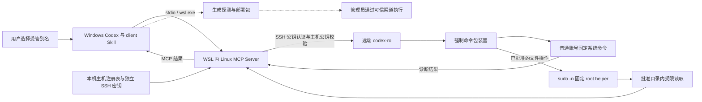

# Linux MCP Server：Windows / WSL 访问受管 CentOS

让 Codex 在明确授权的范围内查看服务器资源、进程、服务和日志，辅助日常排障。一个 WSL 环境运行本地 MCP，通过 SSH 连接多台受管服务器；远端无需运行常驻 MCP 服务。

支持 CentOS 6/7/8 和 Stream 8/9，提供 client Skill、主机管理工具与管理员部署包。

**开始使用：[安装、配置与验证](docs/windows-wsl-setup.md)** · [使用与实现说明](docs/centos-client-guide.md) · [更新记录](CHANGELOG.md)

**交给 AI 安装：[Agent 安装指南](docs/agent-setup.md)**，包含环境补齐、客户端安装、管理员交接与验收。

## 实现方案

日常诊断使用专用账号 `codex-ro`。管理员可启用固定 root 读取 helper，让批准目录内的日志和配置可读；部署与权限变更仍通过管理员的现有运维渠道执行。

## 能力与安全边界

共 19 个固定只读工具：

| 类别 | 工具 | 用途 |
| --- | --- | --- |
| 系统 | `get_system_information`、`get_cpu_information`、`get_memory_information`、`get_disk_usage`、`get_hardware_information` | 操作系统、CPU、内存、文件系统容量和硬件信息 |
| 服务 | `list_services`、`get_service_status`、`get_service_logs` | 服务列表、状态和服务日志 |
| 进程 | `list_processes`、`get_process_info` | 进程资源占用和指定 PID 详情 |
| 网络 | `get_network_interfaces`、`get_network_connections`、`get_listening_ports` | 接口、连接和监听端口 |
| 日志 | `get_journal_logs`、`read_log_file` | 按条件查询 journal 或读取指定日志尾部 |
| 存储与文件 | `list_block_devices`、`list_directories`、`list_files`、`read_file` | 块设备、目录/文件列表和受限文本读取 |

| 范围 | 边界 |
| --- | --- |
| 主机连接 | 仅访问登记主机；每台独立 SSH 密钥，校验主机公钥 |
| 操作接口 | 固定诊断工具，不提供通用 Shell、上传、安装或写入接口 |
| 文件范围 | 每台批准 1..16 个互不重叠的目录，不允许将 `/` 作为批准根；不会自动扩大范围 |
| root 读取 | 保留 codex-ro 登录，仅由专用 helper 读取批准范围；不开放 root SSH 或通用 sudo |
| 管理操作 | 安装、升级和卸载由管理员执行；通过真实 MCP 验收后才登记为可用 |
| 诊断数据 | 文件和日志结果会进入 AI 会话，需按实际数据权限批准读取范围 |

各项能力以主机的 `exact`、`partial`、`unsupported` 画像为准。例如，CentOS 6 缺少 journald 时，相关接口会明确返回不支持。版本差异见 [兼容说明](docs/centos7-compatibility.md)，权限机制见 [使用与实现说明](docs/centos-client-guide.md)。

## 当前实现与已有部署升级

包装器版本 6 已包含以下加固与兼容调整，操作范围仍为固定只读诊断：

- **安装与身份**：升级包核对主机公钥、原客户端公钥及批准目录；安全写入并备份公钥，专用 home、`.ssh` 和 `authorized_keys` 由 root 管理，防止账号移除强制命令。异常链接、错包或范围变化会阻止安装。
- **主机生命周期**：`refresh` 后重新 `prepare` 校验并复用原密钥；实际 `verify` 开始前撤销旧成功状态，保留历史记录并拒绝并发验收，失败或中断不能沿用旧 `verified`。
- **读取预算**：本机和 SSH 在接收时限制输出，默认 stdout 4 MiB、stderr 64 KiB，同一 SSH 连接最多并发两个命令；普通包装器另有 25 秒时限，非阻塞打开后检查文件类型，避免 FIFO 替换阻塞。
- **指标口径**：旧版 `free` 的 available 明确标为估算；目录大小使用实际磁盘占用并返回 `size_basis`，旧包装器画像继续明确标为逻辑大小。

安装器已修复多类型主机公钥共存时的 `invalid public key` 误报：跳过与本次绑定类型不同的候选，仍须匹配登记的完整公钥。这不会开放 ECDSA/DSA 作为受管身份，也不需要删除服务器已有主机公钥。

已有部署按 **更新本机 MCP 与 Skill → 逐主机 `rebuild-deployment` → 管理员安装 → 真实 MCP `verify`** 升级，复用账号、密钥和批准目录。只复制 Skill 或只更新本机 MCP 不会更新远端入口。已经完成版本 6 安装及真实验收的主机，无需仅为上述安装器解析补丁重复安装。具体命令见 [主机生命周期](skills/linux-mcp-server-client/references/host-lifecycle.md)，权限和返回字段见 [升级与指标说明](docs/centos-client-guide.md#升级与诊断指标)。

本轮已在 CentOS 6/7 环境完成真实 MCP 验收，覆盖 19 项能力与画像匹配、批准根内样本的 root 文件/日志/目录读取，以及越界和符号链接拒绝。`partial`、`unsupported` 按实际能力保留；其他部署仍需各自执行验收，不能仅凭安装成功标记 `verified`。

## 使用前需要什么

| 位置 | 环境要求 |
| --- | --- |
| 使用端 | Windows 上的 Codex |
| 本地运行环境 | 一个 WSL 发行版，例如 Ubuntu；安装 git、uv 和 OpenSSH 客户端 |
| 源码安装依赖 | Node.js 22.12+ 与 npm；MCP 要求 Python 3.10+，安装脚本使用独立 Python 3.11 环境 |
| 目标服务器 | CentOS 6/7/8 或 Stream 8/9；SSH、Bash 和 `/usr/bin/python`，兼容 Python 2.6/3.x |
| 部署权限 | 管理员通过可信运维渠道执行一次安装，提前确认允许读取的目录 |

按 [安装指南](docs/windows-wsl-setup.md) 完成本机 MCP、client Skill 和配置，再探测、部署并验收服务器。请从本 fork 的源码安装，同名上游 PyPI 包或镜像不包含本方案的全部配套功能。

安装完成后，可在 Codex 中请求“使用 linux-mcp-server-client 检查 server-a 的 CPU、内存和磁盘”，或“读取 server-a 批准目录内应用日志的最近 100 行”。`server-a` 需替换为已登记别名。

## 进一步阅读

| 需要做什么 | 文档 |
| --- | --- |
| 安装、配置检查与开发验证 | [安装指南](docs/windows-wsl-setup.md) |
| 了解读取模式、维护流程和方案取舍 | [使用与实现说明](docs/centos-client-guide.md) |
| 新增、升级、验收或退役主机 | [主机生命周期](skills/linux-mcp-server-client/references/host-lifecycle.md) |
| 核对管理员安装与权限细节 | [只读入口部署](docs/centos-readonly-overlay.md) |
| 查看系统差异与版本变化 | [兼容说明](docs/centos7-compatibility.md) · [更新记录](CHANGELOG.md) |

基于 [rhel-lightspeed/linux-mcp-server](https://github.com/rhel-lightspeed/linux-mcp-server) 的 fork，沿用仓库 [LICENSE](LICENSE) 及随附许可证要求。
