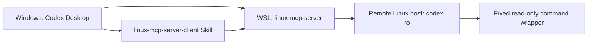

# Personal Windows, WSL, and Remote Server Workflow

This is the personal operating model for using this repository as the single
source of truth for a read-only Linux diagnostics setup. It contains no server
addresses, private keys, passwords, or tokens.

## Components

- **Windows** runs Codex Desktop and stores the personal Skill.
- **WSL** runs `linux-mcp-server` and holds the dedicated SSH key and known-hosts
  data used by the MCP server.
- **This repository** owns the CentOS-compatible read-only overlay, its policy
  template, installer, wrapper, documentation, and tests.
- **Remote hosts** expose only the dedicated `codex-ro` account. SSH public-key
  authentication invokes a fixed read-only wrapper rather than an interactive
  shell.

## Initial workstation setup

1. Install Codex Desktop on the Windows workstation.
2. Install WSL and a supported Linux distribution, then install
   `linux-mcp-server` inside WSL.
3. Configure the `linux-centos-ro` MCP entry in the personal Codex configuration.
   Start from `config/codex-mcp-snippet.toml` and replace every
   `<wsl-user>` placeholder with the local WSL account name. The MCP configuration
   name is not an SSH alias.
4. Install the personal `linux-mcp-server-client` Skill under the Codex skills
   directory. Its default packaging source is this repository.

The local policy file is `config/centos-policy.local.json`. It is intentionally
ignored by Git because it contains deployment-specific approved paths. Create it
from `config/centos-policy.example.json`; never approve `/` as a read or scan
root.

## Adding or selecting a remote server

Use the `linux-mcp-server-client` Skill for every remote-server interaction.

1. The Skill first lists the SSH aliases it manages in WSL. Select an existing
   alias or request a new server configuration.
2. For a new server, the Skill runs the local preparation script. It creates or
   reuses a dedicated ed25519 key, writes only its managed SSH alias, builds a
   deployment archive without the private key, and enables `linux-centos-ro`.
3. The server administrator uploads that archive through a trusted channel,
   verifies the server's ed25519 host-key fingerprint out of band, and runs the
   generated installation command.
4. Supply the verified fingerprint to the Skill. It scans the host key, compares
   it with the verified fingerprint, and adds it to `known_hosts` only on a
   match.
5. Once the MCP server is enabled, diagnostics use the selected managed SSH
   alias as `host` and only fixed read-only MCP tools.

Do not use password authentication, disable host-key checking, use a generic SSH
shell, or collect sudo credentials as part of this workflow.

## Remote account and CentOS 7 compatibility

The fixed name for the managed SSH alias and remote account is `codex-ro`.
`linux-centos-ro` is solely the local MCP configuration name.

For new hosts, the installer creates and marks the account. For a carefully
reviewed legacy `codex-ro` account, the administrator must explicitly pass
`--adopt-existing`; implicit account takeover is intentionally rejected. The
installer rejects UID 0, privileged groups, usable sudo access, unsafe account
layouts, and policy paths outside the approved boundary. Existing wrapper and
policy files are backed up before they are replaced.

The overlay uses descriptor-backed paths and fixed commands so it can safely
provide the compatible read-only operations needed on CentOS 7-class systems.
See `docs/centos-readonly-overlay.md` for the administrator-facing details.

## Daily use and maintenance

- Begin each request by selecting a managed server through the Skill.
- Use only system, service, process, network, disk, log, and approved-path
  queries exposed by `linux-centos-ro`.
- Keep this repository as the only source for future overlay changes and rebuild
  deployment archives through the Skill after changes are validated.
- Do not commit `config/centos-policy.local.json`, generated archives, SSH keys,
  host-key databases, passwords, or tokens.
