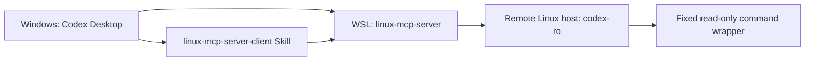

# Personal Windows, WSL, and Remote Server Workflow

This is the personal operating model for using this repository as the single
source of truth for a read-only Linux diagnostics setup. It contains no server
addresses, private keys, passwords, or tokens.

## Components



- **Windows** runs Codex Desktop and stores the personal Skill.
- **WSL** runs `linux-mcp-server` and holds the dedicated SSH key and known-hosts
  data used by the MCP server.
- **This repository** owns the CentOS-compatible read-only overlay, its policy
  template, installer, wrapper, documentation, and tests.
- **Remote hosts** expose only the dedicated `codex-ro` account. SSH public-key
  authentication invokes a fixed read-only wrapper rather than an interactive
  shell.

## Initial workstation setup

1. Install Codex Desktop on the Windows workstation.
2. Install WSL and a supported Linux distribution.
3. Install the personal `linux-mcp-server-client` Skill under the Codex skills
   directory. Its default packaging source is this repository.
4. Run the Skill bootstrap command from Windows. It reinstalls the WSL
   `linux-mcp-server` tool from this repository, creates the local policy from
   the safe example when it is absent, and atomically creates or replaces only
   the `linux-centos-ro` MCP sections in the personal Codex configuration.

   ```powershell
   wsl.exe -d Ubuntu -- python3 /mnt/c/Users/FG/.codex/skills/linux-mcp-server-client/scripts/bootstrap_wsl_mcp.py
   ```

   Restart Codex or open a new Codex session after the bootstrap. The MCP
   configuration name is not an SSH alias.

The compatibility policy `config/centos-policy.local.json` and every
server-specific policy under `config/centos-policies/` are intentionally ignored
by Git because they contain deployment-specific approved paths. The Bootstrap
script creates a safe example when needed. For a new server, the Skill writes a
separate policy named after its SSH alias. Each policy contains one
`allowed_root`, shared by file reads, scans, and log reads; never approve `/`.
The policy does not modify business-file permissions or ACLs.

## Adding or selecting a remote server

Use the `linux-mcp-server-client` Skill for every remote-server interaction.

1. The Skill first lists the SSH aliases it manages in WSL. Select an existing
   alias or request a new server configuration.
2. For a new server, the Skill creates a keyless discovery archive. The
   administrator runs it and returns only the bounded JSON result.
3. Importing the result records the CentOS/OpenSSH profile and displays all 19
   tool capabilities. Partial or unsupported capabilities require explicit
   confirmation.
4. Preparation creates a unique per-host Ed25519 key for CentOS 7/8/Stream, or
   an explicitly allowed RSA 4096 key for CentOS 6. It writes `known_hosts`
   only from a host public key confirmed through a trusted channel and produces
   a deployment archive without the private key.
5. After installation, `verify` calls all 19 tools through MCP and records only
   outcomes and timestamps. Diagnostics thereafter use the exact registered
   alias; unknown IP addresses and hostnames fail closed.

Do not use password authentication, disable host-key checking, use a generic SSH
shell, or collect sudo credentials as part of this workflow.

## Remote account and CentOS 7 compatibility

The remote account is always `codex-ro`. Each remote host has its own managed
SSH alias, and the selected alias is supplied as the MCP `host` argument. The
legacy alias `codex-ro` remains valid for an existing single-host setup.
`linux-centos-ro` is solely the local MCP configuration name.

For new hosts, the installer creates and marks the account. For a carefully
reviewed legacy `codex-ro` account, the administrator must explicitly pass
`--adopt-existing`; implicit account takeover is intentionally rejected. The
installer rejects UID 0, privileged groups, usable sudo access, unsafe account
layouts, and policy paths outside the approved boundary. Existing wrapper and
policy files are backed up before they are replaced.

The overlay uses descriptor-backed paths and fixed commands so it can safely
provide the compatible read-only operations needed on CentOS 7-class systems.
See `docs/centos-readonly-overlay.md` for the administrator-facing details.

To retire a server, the Skill generates an uninstall-only archive after explicit
confirmation. The server administrator executes its command through a trusted
maintenance channel; Codex never performs this remote deletion.

## Daily use and maintenance

- Begin each request by selecting a managed server through the Skill.
- Use only system, service, process, network, disk, log, and approved-path
  queries exposed by `linux-centos-ro`.
- Keep this repository as the only source for future overlay changes and rebuild
  deployment archives through the Skill after changes are validated.
- Do not commit `config/centos-policy.local.json`, generated archives, SSH keys,
  host-key databases, passwords, or tokens.
